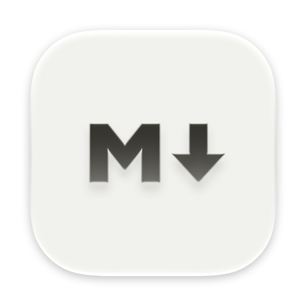
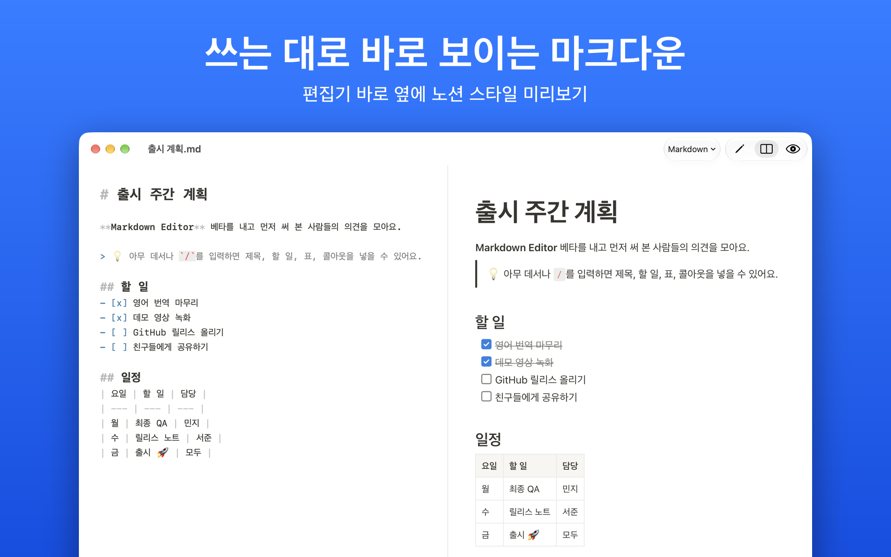
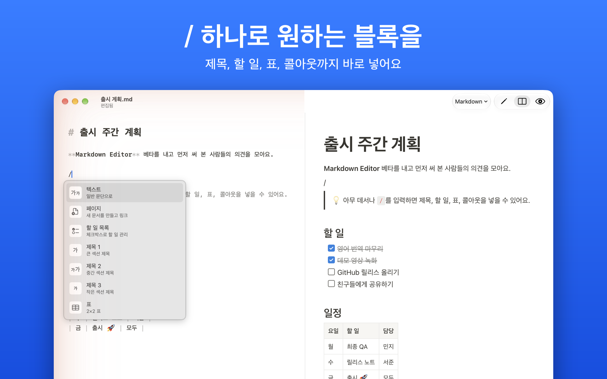
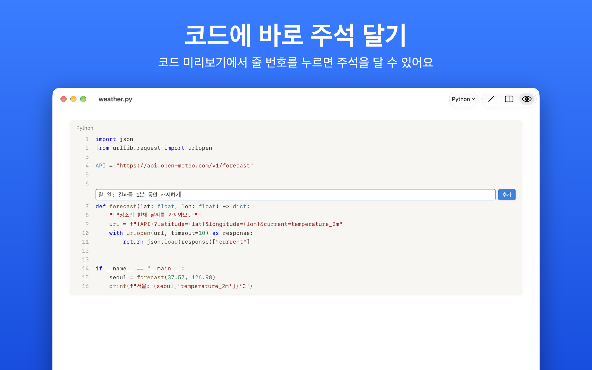
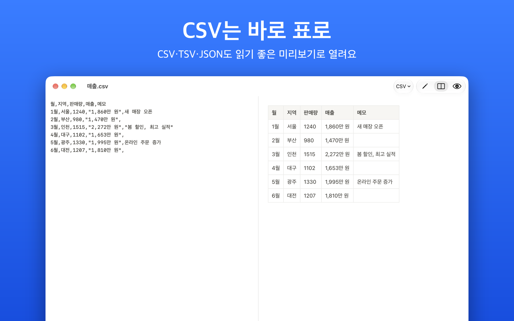
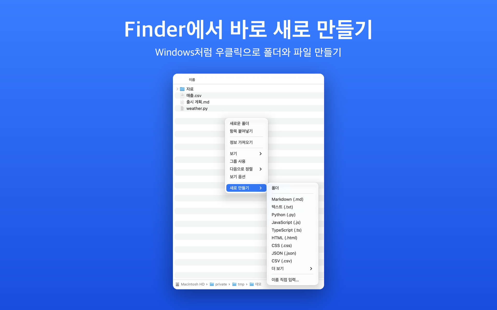

<p align="center">
  
</p>

<h1 align="center">Markdown Editor</h1>

<p align="center">
  노션처럼 보이는 미리보기를 갖춘 macOS용 마크다운·코드 편집기<br>
  <a href="README.md">English</a>
</p>







## 기능

- **실시간 미리보기가 있는 마크다운.** 왼쪽에서 글을 쓰면 오른쪽에 제목, 할 일 목록, 표, 인용이 바로 보여요. ⌘1, ⌘2, ⌘3으로 편집·분할·미리보기를 오가요.
- **슬래시 명령.** `/`를 입력하면 제목, 할 일 목록, 표, 토글, 콜아웃, 코드 블록, 목차, 날짜, 새 페이지 링크를 넣을 수 있어요.
- **코드 에디터처럼 보이는 코드 미리보기.** Python, JavaScript, TypeScript, Go, Rust, Swift, Java, C, C++, 셸, SQL, YAML 등의 코드를 구문 강조, 줄 번호와 함께 보여 줘요. 줄 번호를 누르면 그 언어의 문법에 맞는 주석을 달 수 있어요.
- **데이터 파일.** CSV와 TSV는 표로 열려요. JSON은 올바른지 알려 주고, 틀렸으면 몇 번째 줄 근처인지 짚어 줘요.
- **Finder 연동.** 폴더에서 우클릭하거나 도구 막대 버튼을 눌러 **새로 만들기**를 고르면 폴더나 마크다운·텍스트·코드 파일을 만들면서 바로 이름을 정할 수 있어요. 훑어보기(Quick Look)로 마크다운을 미리 볼 수 있어요.
- **인코딩 유지.** UTF-8(BOM 포함 여부 그대로), UTF-16, CP949 파일을 원래 인코딩으로 저장해요.
- **한국어와 영어.** 설치할 때 언어를 고르거나 macOS 언어를 따르게 할 수 있어요.

## 필요한 것

- macOS 27 이상
- Xcode 27 이상
- [XcodeGen](https://github.com/yonaskolb/XcodeGen) (`brew install xcodegen`)

## 설치

```bash
git clone https://github.com/Rehgud/MarkdownEditor.git
cd MarkdownEditor
./install.sh
```

스크립트가 언어를 물어본 뒤 Release로 빌드해 `/Applications`에 설치하고, Finder와 훑어보기 확장을 등록해요. 질문 없이 바로 설치하려면 언어를 함께 넘기세요.

```bash
./install.sh --lang ko     # 항상 한국어
./install.sh --lang en     # 항상 영어
./install.sh --lang auto   # macOS 언어를 따름
```

`auto`로 설치했다면 시스템 설정 ▸ 일반 ▸ 언어 및 지역 ▸ 응용 프로그램에서 이 앱만 다른 언어로 지정할 수도 있어요.

Finder에서 우클릭해도 **새로 만들기**가 안 보이면 시스템 설정 ▸ 일반 ▸ 로그인 항목 및 확장 프로그램의 확장 프로그램 목록에서 Markdown Editor의 Finder 확장을 켜 주세요.

### 서명

기본은 애드혹(ad hoc) 서명이라 Apple 계정 없이도 빌드한 Mac에서 바로 실행돼요. 내 인증서로 서명하려면 `project.yml` 옆에 `Local.xcconfig`를 만드세요. 이 파일은 커밋되지 않아요.

```
DEVELOPMENT_TEAM = YOURTEAMID
CODE_SIGN_IDENTITY = Apple Development
```

## 개발

Xcode 프로젝트는 `project.yml`에서 만들어요.

```bash
xcodegen generate
open MarkdownEditor.xcodeproj
```

| 폴더 | 내용 |
| --- | --- |
| `App` | 문서 앱: 편집기, 미리보기, 슬래시 명령, 메뉴 |
| `Shared` | 파일 형식, 마크다운·코드 렌더링, 토크나이저, 번역(`Localizable.xcstrings`) |
| `FinderExtension` | Finder 도구 막대 버튼과 우클릭 **새로 만들기** 메뉴 |
| `QuickLook` | 마크다운 훑어보기 미리보기 |
| `Checks` | 토크나이저·주석 검사 |
| `Scripts` | 빌드 보조 스크립트 |

검사는 이렇게 돌려요.

```bash
swiftc Shared/Syntax.swift Checks/main.swift -o /tmp/checks && /tmp/checks
```

언어를 추가하려면 Xcode에서 `Shared/Localizable.xcstrings`와 세 개의 `InfoPlist.xcstrings`에 번역을 넣고, `project.yml`의 `CFBundleLocalizations`에 그 언어를 추가하세요.

## 알려진 한계

- `<!doctype html>` 앞에 주석이나 XML 선언이 있는 HTML 파일은 미리보기가 호환 모드(quirks mode)로 표시될 수 있어요.
- 구문 강조가 Java 주석 안의 `\u` 이스케이프를 인식하지 못해요.

## 라이선스

[MIT](LICENSE)
