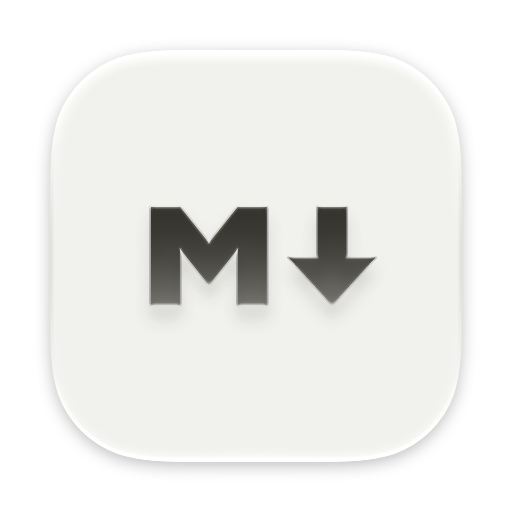
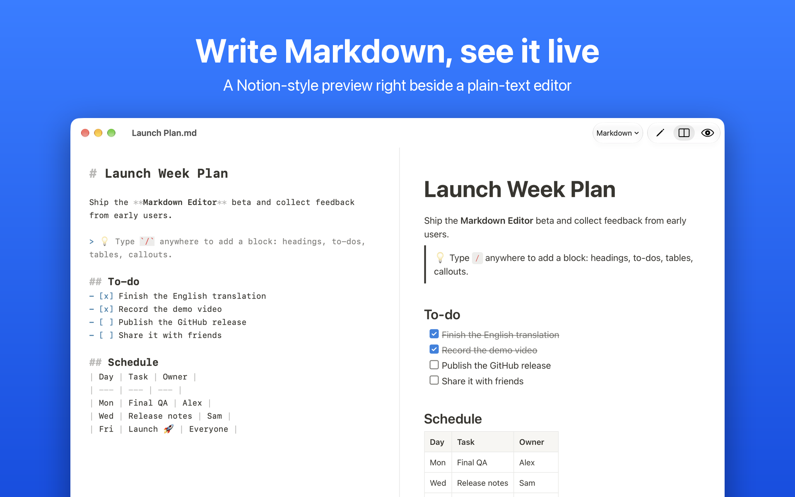
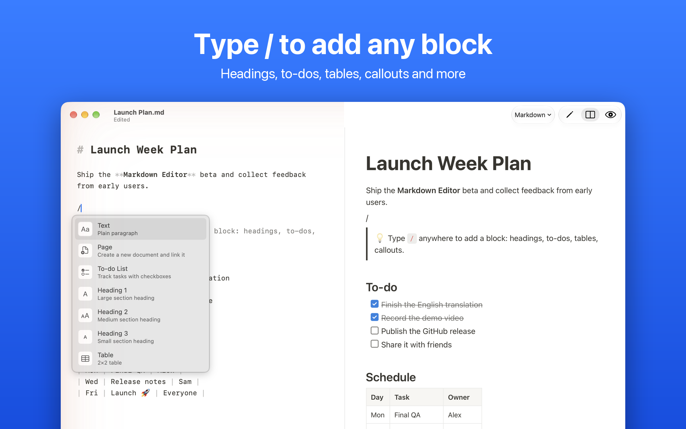
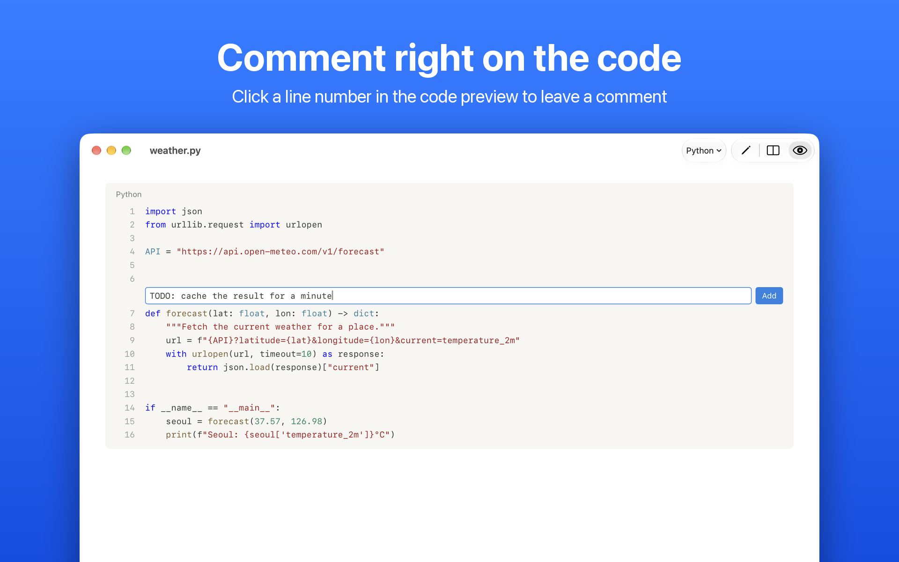
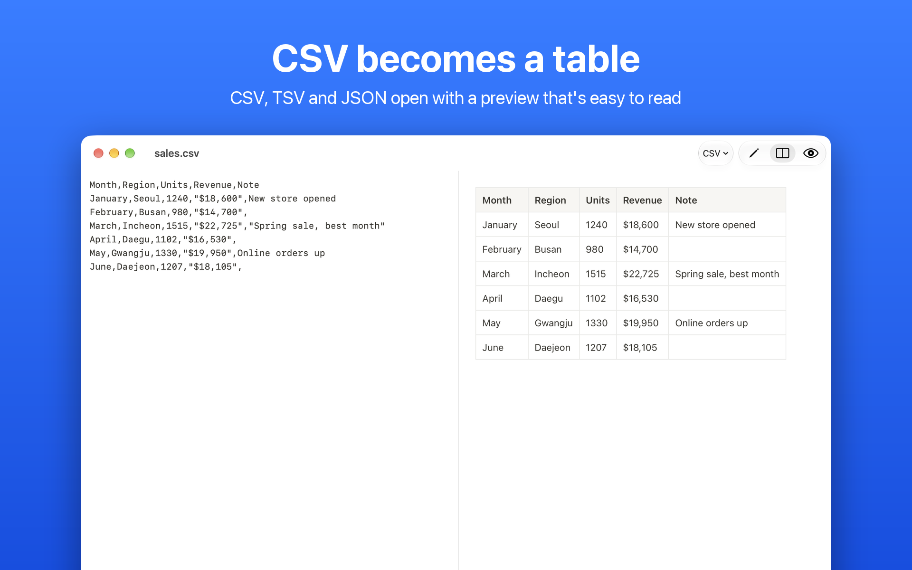

<p align="center">
  
</p>

<h1 align="center">Markdown Editor</h1>

<p align="center">
  A native macOS editor for Markdown and plain-text code, with a Notion-style preview.<br>
  <a href="README.ko.md">한국어</a>
</p>






## Features

- **Markdown with a live preview.** Edit plain text on the left and see headings, to-do lists, tables and quotes rendered on the right. Switch between Edit, Split and Preview with ⌘1, ⌘2 and ⌘3.
- **Slash commands.** Type `/` to insert a heading, to-do list, table, toggle, callout, code block, table of contents, date or a link to a new page.
- **Code files with a code-editor preview.** Python, JavaScript, TypeScript, Go, Rust, Swift, Java, C, C++, shell, SQL, YAML and more open with syntax highlighting and line numbers. Click a line number to add a comment in that language's syntax.
- **Data files.** CSV and TSV open as tables. JSON shows whether it's valid, and points to the line when it isn't.
- **Finder integration.** Right-click in a folder, or use the toolbar button, and choose **New** to create a folder or a Markdown, text or code file and name it right away. Quick Look previews Markdown files.
- **Keeps your encoding.** UTF-8 (with or without BOM), UTF-16 and CP949 files are saved in their original encoding.
- **Korean and English.** Choose the language when you install, or let it follow macOS.

## Requirements

- macOS 27 or later
- Xcode 27 or later
- [XcodeGen](https://github.com/yonaskolb/XcodeGen) (`brew install xcodegen`)

## Install

```bash
git clone https://github.com/Rehgud/MarkdownEditor.git
cd MarkdownEditor
./install.sh
```

The script asks which language to use, builds the app, installs it to `/Applications` and registers the Finder and Quick Look extensions. To skip the question, pass the language:

```bash
./install.sh --lang en     # English everywhere
./install.sh --lang ko     # Korean everywhere
./install.sh --lang auto   # follow the language macOS uses
```

With `auto`, you can still pick a language for this app alone in System Settings ▸ General ▸ Language & Region ▸ Applications.

If the **New** item doesn't appear when you right-click in Finder, turn on Markdown Editor's Finder extension under Extensions in System Settings ▸ General ▸ Login Items & Extensions.

### Signing

Builds are signed ad hoc, so they run on the Mac that built them without an Apple account. To sign with your own certificate, create `Local.xcconfig` next to `project.yml` (it isn't committed):

```
DEVELOPMENT_TEAM = YOURTEAMID
CODE_SIGN_IDENTITY = Apple Development
```

## Development

The Xcode project is generated from `project.yml`:

```bash
xcodegen generate
open MarkdownEditor.xcodeproj
```

| Folder | What's in it |
| --- | --- |
| `App` | The document app: editor, preview, slash commands, menus |
| `Shared` | File formats, Markdown and code rendering, the tokenizer and the translations (`Localizable.xcstrings`) |
| `FinderExtension` | The Finder toolbar button and right-click **New** menu |
| `QuickLook` | The Quick Look preview for Markdown |
| `Checks` | Tokenizer and comment checks |
| `Scripts` | Build helpers |

Run the checks with:

```bash
swiftc Shared/Syntax.swift Shared/Render.swift Shared/FileFormats.swift Checks/Stubs.swift Checks/main.swift -o /tmp/checks && /tmp/checks
```

To add a language, add it to `Shared/Localizable.xcstrings` and the three `InfoPlist.xcstrings` files in Xcode, then add it to `CFBundleLocalizations` in `project.yml`.

## Known limitations

- An HTML file with a comment or an XML declaration before `<!doctype html>` can preview in quirks mode.
- Java `\u` escapes inside comments aren't recognized by the syntax highlighter.

## License

[MIT](LICENSE)
